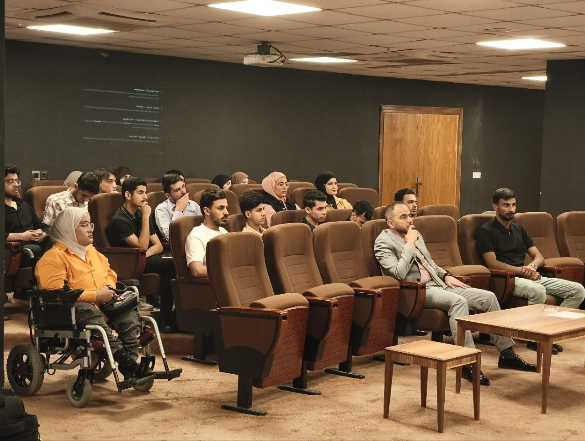

# ورشة آفاق التعليم الأكاديمي والمهني

ورشة من تنفيذ فريق **سايبر آي كيو (Cyber IQ)** — الجامعة العراقية، كلية الهندسة، قسم هندسة الشبكات والأمن السيبراني.

## نبذة

ورشة تعليمية تفاعلية تقدّم للطالب تصوّراً شاملاً عن دراسة هندسة الشبكات والأمن السيبراني، وتربط الجانب الأكاديمي بالمهارات التقنية والمسارات المهنية المستقبلية. قُدّم محتواها على شكل خارطة طريق عبر واجهة HTML تفاعلية بالعربية.

> **العرض التفاعلي المباشر:** [hfsduu5-coder/Workshop2](https://github.com/hfsduu5-coder/Workshop2)

## المحاور

- الشبكات وأنظمة التشغيل والبرمجة.
- الأمن السيبراني (Red Team / Blue Team) والتخصصات الأمنية.
- أهمية الجانب الأكاديمي والتعلم الذاتي.
- المسارات المهنية بعد التخرج (الحكومي، العسكري، القطاع الخاص، الأكاديمي، العمل الحر).

## الرسالة الأساسية

الدراسة الأكاديمية تمثّل الأساس، بينما يكتمل التأهيل عبر التعلم الذاتي والتدريب العملي والمشاريع والتخصص.

## الفئة المستهدفة

طلبة القسم والمهتمون بالدخول إلى مجال الأمن السيبراني.

---

**EN:** *Academic & Professional Horizons* — an interactive Arabic (RTL) workshop by Cyber IQ introducing students to the Networks & Cybersecurity Engineering field: networking, OS, programming, cybersecurity (Red/Blue Team), academic study and professional career paths. Live interactive presentation: [Workshop2](https://github.com/hfsduu5-coder/Workshop2).

Part of [Cyber IQ — CYBERIQ-HQ](https://github.com/CYBERIQ-HQ)

